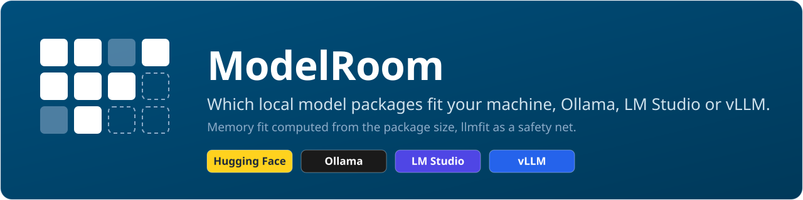

# ModelRoom

Does this model have room on your machine?

MIT licensed, Python, on PyPI as `modelroom`.

ModelRoom (package and command: `modelroom`) answers two questions for a list of model
families you care about:

1. **Which local packages exist?** It reads the Hugging Face API and the Ollama registry and
   records each package with its size, format, quantization and exact revision.
2. **Which of them fit a given machine?** It measures the computer itself, cross-checks the reading
   with [llmfit](https://github.com/AlexsJones/llmfit) when installed, and computes whether weights, KV cache and a reserve fit.

A machine, here, is one computer you want to size: a laptop, a workstation or a server, local or
rented.

The result is a JSON snapshot, one hardware profile per machine and a rendered Markdown document
with a ranking per configured machine.

Start: [Quick start](#quick-start). Depth: [The guided run](#the-guided-run), [Runtimes](#runtimes),
[Reference](#reference). Terms: [Words used here](#words-used-here).

## Status

Version 1.0.0 (see `CHANGELOG.md`, which lists what has landed). The guided mode and the
subcommands work end to end. The data shapes are versioned contracts (see `CONTRACTS.md`).

The branch `main` runs ahead of the release on PyPI. What `CHANGELOG.md` lists under "Unreleased"
is in this repository and not yet in the package an installer fetches.

## Quick start

Install the command-line tool from the Python Package Index with either installer:

```bash
uv tool install modelroom
pipx install modelroom
```

Then check that the command is there; it prints the version and asks nothing:

```bash
modelroom --version
```

Both put `modelroom` into an environment of their own. Both need the installer itself,
[uv](https://docs.astral.sh/uv/) or [pipx](https://pipx.pypa.io/), and Python (see "Requirements").

If the command is not found afterwards, the installer's folder is not on `PATH` yet. Run
`uv tool update-shell` or `pipx ensurepath` once and open a new terminal.

Open a terminal in the folder where the results should live and type the command:

```bash
modelroom
```

It opens with what it already knows and then walks five numbered steps. Every step is a block of
its own. A question disappears once it is answered, and one line takes its place with the answer
in the words you gave it. Each step writes its files as it goes.

In a list the arrow keys move, `Space` marks a row, and `Enter` takes what is marked or, with
nothing marked, the row under the pointer. `Esc` leaves a list, Ctrl-C leaves at any point.

The next run is the same command: it remembers the folder, the computer it measured and the
context you chose.

The guided mode needs no configuration file: it writes one into the folder you choose. The
subcommands start from `modelroom.example.toml` in this repository (see "Other ways to run").
Nothing in the tool is tied to a specific operator: you bring a configuration file with your
families, packagers and machines, run it on the computer you want to size, and keep the files
wherever you keep your notes.

## Requirements

- Python 3.11 or newer and [uv](https://docs.astral.sh/uv/).
- `llmfit` 1.1.16 or newer on `PATH` is optional. The cross-check named at the top covers the
  physical RAM and the graphics memory. `llmfit` is also the fallback where `hardware` counts no
  card of its own; a card llmfit counts says so with the source `llmfit`. Without it the command
  still succeeds: the RAM check is `absent`, and so is the graphics check, except where no
  comparison could be made anyway (cards of different sizes, or cards named but none counted:
  `not_comparable`, `CONTRACTS.md`, "Cross-check with llmfit"). The minimum version is set in the
  configuration (`[llmfit] min_version`).
- The graphics cards are read from each vendor's own source. NVIDIA is read from `nvidia-smi` (one
  card or several). AMD on Linux is read from the kernel (sysfs, with the ROCm compute driver).
  Apple Silicon is read from `sysctl` as one pool of unified memory. Every other unit is read from the system's list of display adapters
  (`lspci` on Linux, `Win32_VideoController` and the registry on Windows). `hardware` prints one
  line per unit: vendor and model, memory, source, and whether it is usable for Ollama and
  counted. A card that is not counted (integrated graphics, a card only Vulkan can use, a card
  whose driver tool is missing) computes as a computer without a card.
- An Ollama daemon on `http://127.0.0.1:11434` for the load test only. Without one the guided
  mode says so in one line and goes on; nothing else in the tool needs it.
- An LM Studio server on `http://127.0.0.1:1234` whose `/api/v1/models` lists its models, to be
  detected and, with exactly one loaded model, measured.
- Internet access for the search and the fetch.

### Tested on

Every computer a version really ran its self-test on (`scripts/selftest.py`), one line each. The
two-card fixtures were recorded on the Verda and Scaleway instances listed below. The fixtures of
three graphics cards and more, and of cards of mixed sizes, are synthetic (`tests/fixtures/README.md`).

The load test is the speed the self-test measured for
`hf.co/unsloth/DeepSeek-R1-0528-Qwen3-8B-GGUF:Q4_K_M` at context 8192, one request. The Class
column is what the profile says: `server (entered)` means the run supplied the computer's class.

| Machine | Class | Graphics cards | Memory | Date | Self-test | Load test |
|---|---|---|---|---|---|---|
| a laptop of the maintainer | laptop (chassis) | 1 x NVIDIA RTX PRO 3000 Blackwell Generation Laptop GPU, 11.94 GiB | 127.46 GiB | 2026-09-27 | `SELFTEST: OK` | 56.9 tok/s |
| a rented instance at Verda (Helsinki) | server (entered) | 2 x NVIDIA A100-SXM4-80GB, 80.00 GiB each | 235.92 GiB | 2026-09-27 | `SELFTEST: OK` | 143.5 tok/s |
| a rented instance at Scaleway (Paris) | server (entered) | 2 x NVIDIA L4, 22.49 GiB each | 94.29 GiB | 2026-09-27 | `SELFTEST: OK` | 48.2 tok/s |
| a rented instance at Seeweb (Frosinone) | server (entered) | 1 x NVIDIA L40S, 44.99 GiB | 31.27 GiB | 2026-10-08 | `SELFTEST: OK` | 122.8 tok/s |

## The guided run

The pictures come from three runs on a rented server at Seeweb with one NVIDIA L40S graphics card
(44.99 GiB) and 31 GiB of memory. The folder is `/srv/models`, chosen for the pictures; any
folder does.

Ollama 0.40.1 runs there without a package of the model the run looks for. A vLLM server serves
`Qwen/Qwen3.5-4B` at context 4096. The pictures were taken on Linux; for Windows and macOS, see
"vLLM".

The first picture is from the initial run in a fresh folder. Pictures 2 to 8 are from the second
run. The last picture shows a separate run with an empty search word in the same folder. Your
numbers, and so the fit of every package, will differ.

### Start


Start shows what the run knows before it asks anything.

**What you see.** Four facts before the first question:

- the **folder**: none chosen yet;
- the local **daemon**: Ollama 0.40.1 is reachable, with one model;
- the vLLM **server**: context 4096, and the model it states it serves;
- this **machine**: its name, and that no measurement is stored in this folder yet.

A running LM Studio server adds a row of its own under them, here for one loaded instance
(`server  LM Studio  1 loaded: <id>, context <n>`; see "LM Studio"). The second run started in
the folder the first one chose and was not asked again. The first question of step 1 follows.

### Step 1, Configuration


Step 1 decides where the results live and which machines the result covers.

**What you choose.** First the folder, when the current one is not configured yet:

- the folder you are in;
- the folder the last run used, offered first with the pointer on it when you start in another
  one. The start screen already says `the folder of the last run, not this one`;
- another path;
- in your home folder or at the top of a drive, the run asks before it writes and offers `<home>/modelroom`.

Then the machines the result covers. Nothing in the list is marked in advance, and the result
covers exactly the machines you marked in this run. The list has these rows:

| Row | What it does |
|---|---|
| **this machine**, with its profile as the first row, `this machine (server-d4944767, as measured 2026-10-08)` | Where this computer was measured in this folder before. The name is the one the result shows for it. Enter alone keeps the profile and measures nothing. |
| **this machine** with `measure now` or `measure again` | Measures this computer right here, once the question is answered. `measure again` is the row under the profile. |
| a **profile file**, `import a profile file` | Takes in a profile measured on another computer. |
| a machine **entered by hand** | Opens the questions listed below. |
| every other profile of the folder | Each is a row of its own. |
| `a computer over SSH (its host alias)` and the shared folder | Reach another computer (below, and "Another computer"). |

Measuring asks what kind of computer this is. The class the chassis reports is already marked:

- a laptop;
- a workstation;
- a server.

Keeping the marked class keeps the chassis as the source of the class; another answer is `entered`.

A machine you do not have yet can be **entered by hand** from its data sheet. It asks for:

- its name;
- whether it is a laptop, a workstation or a server;
- its memory;
- whether a graphics card with its own memory, several graphics cards of one size, no graphics
  card or unified memory runs the model.

The shared folder serves a computer without SSH. `set up a shared folder for profiles` is always
in the list; once a folder is set, it reads `profiles from the shared folder`.

Choosing it opens "Shared folder". There `choose a folder` takes a folder on this computer, a
network drive such as `Z:\profiles` or `\\nas\profiles`, or your cloud sync folder. Later runs let
you change it with `change the folder` or forget it with `none, no shared folder`.

For a script, `MODELROOM_PROFILE_SHARE` sets the folder and wins over the kept one. The step then
says `set by environment`. The shared folder is read and written like any local one, whatever the
operating system mounted there, network shares and cloud sync folders included.

**What you see.** In the picture the first row reuses the profile measured in the first run, and
the start screen sums it up (`server, one graphics card, 45 GB, 31 GB memory`). The gray line
above the question says where another computer's profile comes in.

A machine entered by hand has a place in the result of its own, next to the machines you
measured. It says `(entered)` wherever its name stands. Every number of such a machine is
computed, none measured.

**What is written.** The folder you chose holds `modelroom.toml`, `docs` and `state`. A machine
that is measured, imported or entered gets its profile in `state/hardware/`.

An `import` checks the file's schema and its name. A file copied by hand into `state/hardware/` is
taken up by the next run.

For a shared folder the step first checks that it can write there. It then keeps the folder for
your user account in `~/.modelroom/remote.json`. Only this step shows the folder (see "Names and
folders").

#### Another computer

A folder can hold the profiles of several computers, such as your laptop and a rented server.

**By file.** Bring a profile over by hand. On that computer, with a `modelroom.toml` of its own,
run `modelroom hardware --config modelroom.toml` and then
`modelroom export-profile --config modelroom.toml --out <name>.json`.

Back here, choose `import a profile file`. A computer can also be entered by hand (see step 1).

Three more ways reach another computer directly:

1. **Copy the command.** At the end of a run, step 5 can hand you a line to paste on that computer.

   That line is `modelroom pull <name> --weights-bytes <n>` where modelroom is installed there
   too, else the plain `ollama pull <name>`. Nothing is sent anywhere on its own; you paste it
   yourself.
2. **A shared folder.** Choosing and keeping the folder is step 1. Here is the export onto it.

   Export the profile as under **By file**, but onto the folder:
   `modelroom export-profile --config modelroom.toml --out <share>/<name>.json`. That drops a
   profile into the folder.

   Name the file after the export's own neutral name, such as `server-3f9a0c21.json`. That is
   what other computers pick it up by, never the file name.
3. **Over SSH**, with modelroom 0.2.0 or newer and Ollama on the server. Step 1's row
   `a computer over SSH (its host alias)` asks for your own SSH host alias for it (`~/.ssh/config`).

   Use a neutral name of your own, such as `gpu1`, not the server's real one: modelroom keeps
   whatever you type and cannot tell the difference.

   It reads the server's profile. It lets step 5 check the server's free disk and pull the package
   you choose for it, checked, asked, one Yes. You never run modelroom there by hand.

   It runs the system `ssh` straight to that alias with a fixed, safe set of options. It never
   asks for a password and never accepts a host key it does not already know.

   Behind a jump host these two promises hold only for the target itself. The jump host answers
   with its own connection, under its own `Host` block (below). It needs `BatchMode yes` and
   `StrictHostKeyChecking yes` there too for the same guarantee.

   A server is told apart by its machine identity, on Linux the `/etc/machine-id`. Where a server
   gives none and a saved profile is there to compare with, modelroom cannot tell whether it is
   still the same computer. It says so once and asks nothing, unless it had one before.

**Setting SSH up, once**, on Windows, macOS or Linux:

- **Client.** Windows 10 1809 and newer, and Windows Server 2019 and newer, already carry the
  OpenSSH client; otherwise install it from Settings, Optional features, OpenSSH Client.
- **A key.** `ssh-keygen -t ed25519`, with a passphrase.
- **An agent.** Windows: start the OpenSSH Authentication Agent service, then `ssh-add`. macOS:
  `ssh-add --apple-use-keychain`. Linux: `ssh-add`.
- **The public key on the server.** `ssh-copy-id gpu1` on macOS or Linux. On Windows, copy
  `id_ed25519.pub`'s content into the server's own authorized-keys file by hand.

  A normal account keeps that file at `%USERPROFILE%\.ssh\authorized_keys` (the same file as
  `~/.ssh/authorized_keys` elsewhere). An account in the Administrators group keeps it instead at
  `C:\ProgramData\ssh\administrators_authorized_keys`.

  Its permissions must be restricted to `SYSTEM` and `Administrators` alone, because sshd refuses
  a looser file. Two commands do that. The first drops every entry set on the file itself. The
  second drops the inherited ones and grants full access to these two alone.

  Both name them by their security identifiers, SIDs (`S-1-5-32-544` for `Administrators`, `S-1-5-18`
  for `SYSTEM`), with a leading `*`. That is the form Microsoft's OpenSSH-for-Windows documentation
  gives for a Windows in another display language, where the names differ:

  ```
  icacls.exe "C:\ProgramData\ssh\administrators_authorized_keys" /reset
  icacls.exe "C:\ProgramData\ssh\administrators_authorized_keys" /inheritance:r /grant:r "*S-1-5-32-544:F" "*S-1-5-18:F"
  ```

  `icacls.exe "C:\ProgramData\ssh\administrators_authorized_keys"` then lists exactly two entries,
  both ending in `:(F)`. They are `SYSTEM` and the built-in `Administrators` group, each under the
  name the system's display language gives it.
- **The host alias**, in `~/.ssh/config` (Windows: `%USERPROFILE%\.ssh\config`):

  ```
  Host gpu1
      HostName 192.0.2.10
      User user
      IdentityFile ~/.ssh/id_ed25519
  # behind a jump host:
  #   ProxyJump jump1   (with its own Host jump1 block, StrictHostKeyChecking yes and BatchMode yes)
  ```

- **The first connection, by hand.** `ssh gpu1` once, and check its host key when asked.
- **modelroom on the server**, on the `PATH` of an SSH session: `uv tool install modelroom` and
  `uv tool update-shell`; without that, modelroom falls back to `~/.local/bin/modelroom` once.

**What is kept.** For an SSH computer: the alias, in `~/.modelroom/remote.json` and as the
computer's name. For a shared folder: see step 1. Nothing else about the connection, the files in
the shared folder, or the other computer's name.

Computer names throughout the result follow the same rule as this computer's own (see "Names and
folders").

### Step 2, Packages

Step 2 decides which models and packages the run looks at.


**What you choose.** What you are looking for; in the picture `qwen 3.5 4b`. There are four ways
to answer, and none of them has to be the exact spelling of anything:

| What you type | What happens |
|---|---|
| `qwen` | the word goes to the Hub, and every account is asked for it |
| `qwen 3.5 9b` | blanks, hyphens, underscores and colons all separate words; one of them is asked for and the rest narrow the answer, so a missing hyphen, a blank in the wrong place or a `gguf` you wrote out of habit still find the model. The words themselves have to be right: `9x` finds no `9B` |
| `unsloth/Qwen3.5-9B-GGUF` | a repository you already know: one request for exactly that one, and the owner filter never hides it. If it cannot be read or holds no GGUF file, the words of its name are searched instead |
| nothing at all | press Enter and the current models of the shipped catalog are looked up one by one -- the answer to "I have no model in mind, what fits this machine?" (see the last picture) |

**What you see.** A word close to something the catalog knows that finds nothing to pick (`qwn`)
ends in a short list of what you may have meant. Picking one searches again.


**What you choose.** The owner filter, yes or no. **Yes** (the default) keeps the list to the
publisher of what you searched for and the packagers configured for the folder.

By default these are five packagers (`unsloth`, `bartowski`, `mradermacher`,
`lmstudio-community`, `ggml-org`). Each is asked for its newest and its most downloaded
repositories.

**No** adds the twenty most downloaded and the ten newest repositories for that word, whoever
owns them.

**What you see.** With **No**, a model of a publisher the catalog does not know can be picked as
well (see "Publishers the search resolves").


**What you choose.** One or more models from the list, one row per model that can really be
picked. Mark the rows you want, or take the row under the pointer.

**What you see.** The rows follow one rule. What fits into the graphics card comes first, a model
with a named successor (`legacy`) last, and otherwise the largest model first. The result follows
the same rule. The column head stays above the list while you scroll.

| Column | What it says |
|---|---|
| **Fit** | What the model's size allows on this computer at the folder's context (see "Step 3, Context"): `fits`, `tight`, `no_fit`, the share of the memory it needs. `fits (RAM)` means it needs system memory rather than the graphics card's. The gray line under the question says what each word means. After the fetch the fit is computed per package from what the fetch found. |
| **Size** | The parameter count. |
| **Release** | `latest` when the publisher's own page names this model as the current one of its family, `legacy` when the publisher named a successor, and `–` when nothing decides it. |
| **Packagers** | The accounts that offer a GGUF build of it (the first one and how many more, `unsloth +3`, where they do not all fit). |
| **Downl.** | The downloads of all of them together. |
| **Ollama** | The name of the same model in the Ollama registry when the catalog or your configuration knows one. A name longer than its 14 characters is cut, and the install line at the end carries it whole. |

A **`*`** behind the word (`latest*`, `legacy*`) means the status is computed from the version
numbers of the family, not stated by the publisher.

Where the catalog is silent, the highest version of a family and variant is `latest*` and every
lower one `legacy*` (`state/search.json` names the successor). It compares only what the search
and the catalog know.

In the picture the search found 8 repositories and one model to pick, `Qwen3.5-4B`, and it is
marked. It shows `fits` at the folder's 4k, `legacy*` because a higher version of the family is
known, `unsloth +2` and `qwen3.5:4b`.

The packages come from Hugging Face (the model's publisher, RedHatAI for vLLM builds and the
listed GGUF packagers) and from the Ollama library. The start screen shows the runtimes, not the
origins; the origin stands with each row at the package name (`<packager> · <quant>`).

**What is written.** `state/search.json` records what the search asked, page by page. It counts
the repositories that are no model of the list, and why, rather than showing them as rows nobody
can choose.

After the choice the run fetches, per model, the packages of the publisher's own repository and of
the first listed packager that has it. It records them.

### Step 3, Context


Step 3 decides how many people work with the model at the same time and how much text it handles
at once.

**What you choose.** First, how many people work with it at the same time. The answers are:

- 1, 5, 10, 50 or 100;
- a number of your own;
- for whoever only knows how many people use it on a day, that head count typed as `250 people`.

modelroom assumes one request at a time per person working with the model. A daily head count
becomes requests by a rule of thumb, 1 in 10 at the same moment, so 250 people are 25 requests.
The rule is not measured, and the gray line under the list says so. Every request holds its own
KV cache in memory. From about 10 at once a serving stack such as vLLM is the runtime to look at.

Then how much text a model should handle at once, as a scale from XS to XXL. **L** (32k, a report
or a long contract) is the default for a new folder. A number of tokens can be typed instead.

**What you see.** The scale shows the tokens, the words that are and an example for each level.

The last column is the point of the question. It shows how many of the packages just fetched still
fit this computer at that context and for those requests. The memory a model needs grows with the
text it holds.

The picture shows the question of an earlier version, which asked for a daily head count: the
folder offers what the first run chose, 25 people (3 requests), and **XS** (4k, the context the
vLLM server runs at). On the L40S all 26 fetched packages fit at every level.

**What is written.** A folder keeps the answer it was given and offers it next time. It gets a line
of its own when the number is none of the five or was derived from a daily head count. It keeps the
level it chose last time too.

### Step 4, Measurement


Step 4 decides whether a local server is measured now.

**What you choose.** One question for every local server: **Measure the speed on this machine
now?** **Yes** shows one list: the installed packages, the vLLM server and the LM Studio server,
nothing marked. You pick what to measure.

**No** skips new measurements. A row without a stored measurement shows `–` for speed.

**What you see.** First each server says what it has:

- the packages of this run's models your Ollama daemon already has;
- where a vLLM server answers, which model it serves and whether its number will count.

The number counts for this run when the server serves a model you chose, at the context you chose.

An LM Studio server with exactly one model loaded is offered as a row too (see "LM Studio").

An Ollama measurement runs a short prompt through the package and never downloads anything. The
prompt goes through the template of the model (protocol v2). The balance says `vLLM measured` only
where the number counts, else `vLLM ran, not counted`.

When the ranking assumes more than one request, a measured row names why its speed does not count
there. An invalid run (see **What is written.**) gets a second line that says how far it got
(`run 1 ended after 2 of 128 tokens`) and what the protocol counts.

In the picture the list holds only the vLLM server, as the setup above says. It states which model
it serves, but not which revision (`revision unknown (not stated)`).

One warm-up request, then three batches of 3 requests of 128 tokens each give `204.7 tok/s total`,
68.5 per request. The lines under it are computed, not measured.

vLLM takes 0.92 of the one card of 44.99 GiB. That share holds the weights (8.68 GiB), its runtime
(1.50 GiB) and 179 requests of context 4k at once.

**What is written.**

- A new valid Ollama measurement is saved, as tokens per second.
- A measurement stored earlier stays in the ranking, but only for the same package content at the
  same context.
- Measurements stored under protocol v1 keep counting and are shown as such (`protocol v1`).
- An LM Studio measurement is not saved and not ranked.
- In modelroom 0.2.0 a vLLM number is shown for the current run only. It is saved nowhere and
  assigned to no package (`identity stated by the server; not ranked, nothing written`).
- A run that ends before 128 tokens is invalid, and the package stays without a speed.
- An Ollama measurement always runs one request. When the ranking assumes more, the step says
  so first.

### Step 5, Results


Step 5 decides which package is installed here or handed over to another computer.

**What you choose.** Where the local Ollama daemon answered, the run lists the rows shown. It asks
**Which package should be pulled into Ollama?** or, where the list has vLLM or LM Studio entries,
**Which package should be installed?** (as in the picture). Any row can be chosen, not only #1.

Some rows are locked:

- an Ollama row without an Ollama name;
- a row whose pull name is not unique;
- a row whose download is too large for the free disk, shown in red with what it needs.

The command of the choice follows. Then **Pull #1 into Ollama now?** asks, with the size of the
package (7.8 GB in the picture). **Yes** pulls it into the daemon and shows the progress. **No**,
the answer in the picture, leaves the command for you to run.

Too little disk (see **What is written.**) says so and asks nothing. A row the daemon already
has gets a note instead of the question. After the package has been installed, step 4 of a later
run offers to measure it.

Where the table of another computer has a package of its own, step 5 also asks, afterwards:
**Which package should go onto another computer?** It asks even when the run only ever imported
that other computer and never measured or ranked this one.

The question lists the rows of every other chosen machine under its own heading. Choosing one
hands over the command for that computer (see "Another computer"). So a computer reached only by
copy-paste, not by this run's own daemon, still gets its package.

**What you see.**

| Part | What it shows |
|---|---|
| The card | The card of the whole run: folder, machine, models, context, speed, and where the result went. In the picture the run chose `Qwen3.5-4B`, 26 packages from Qwen, unsloth and RedHatAI, all ranked, none without a fit. |
| The context row | The whole scenario: the context, the KV cache and the requests with where they came from (`3 requests (from 25 users)`). Beyond eight requests a `load` row adds that the fit says nothing about throughput. |
| The speed row | No Ollama package was measured in the picture (`speed  not measured`). The vLLM server's number stands in the **server** row instead: `204.7 tok/s total, 3 requests at once, counts for this run`. Under it stands the fit computed for it (`179 at once, ample`). |
| The ranking | The ranking for this computer at the chosen context, one section per runtime (`with Ollama`, `with vLLM`: alternatives on the same card, not both at once). A row gives rank, model, package (packager and quantization), fit, measured speed and memory need. |
| The speed cells | Every one reads `–`. For the Ollama rows nothing was measured. For the vLLM rows, see **What is written.** in "Step 4, Measurement". The measured total appears only on the run card. |
| The order | Graphics memory ranks before system memory. The first row is the largest model that fits, in the least compression of it that fits. Of two packages of one model that both fit, the less compressed one ranks first. A measurement only decides between two builds of the same compression. modelroom rates no model family against another. |
| The rows shown | With several models the table shows one row per model, its first-ranked package. A package you measured here that the rule leaves out is added at the end with its place. The result shows only the models this run chose; a later `modelroom render` shows the whole folder again. |
| The **install** line | The command for the first row, ready to paste. Rows that look alike name their repository under the table. |
| The **room** line | See "What the fit class means". |
| The **memory** line and the **Download** column | The **memory** line names the budget of each pool. The **Download** column is what a pull of that row brings. |
| A row that does not fit the disk | A row whose download is too large for the free disk (the rule is under **What is written.**) stays where the fit puts it. It lies on red and carries ` ×` behind its download (also without color and in `docs/models.md`). A red **disk** line under **memory** names those rows. The **install** line then takes the first row that also fits the disk. Failing that, it says in red that no package fits and space must be freed first. |
| A computer that is not this one | Imported, entered by hand, or another profile of the folder: it says so on the card and in its table head. It gets its command to copy there, or over SSH the pull there. A row the SSH computer already has ends `local already` in the list below. |

The notes under the tables say:

- what is **shown** (10 of 22 for Ollama, 4 of 4 for vLLM);
- which rows fit into graphics **memory** and which need system memory;
- which rows have their fit computed from the package size as their **basis**, not from the
  architecture (the line appears only for such rows);
- what was measured for **speed**;
- a **local** line with the rows Ollama already has, where that computer's Ollama was asked (this
  computer, or the computer over SSH);
- the **key**, which says what the fit words mean.

**What is written.** The ranking, with the totals and what was set aside, goes to `docs/models.md`
and `docs/models.json`.

An optional installation uses Ollama's store, `~/.lmstudio/models` (LM Studio) or vLLM's Hugging
Face cache; download plus 1 GB must fit its free disk, rechecked beforehand.

## Other ways to run

### Nothing in mind


The empty search word, the last row of the table in "Step 2, Packages", looks up one page for each
current model of the shipped catalog. They are listed by the rule of the rows there.

In the picture the run searched for the 22 current models of the catalog and found 214
repositories, 35 of them models to pick. On the L40S everything from 32B down `fits`, the two
models of about 120B are `no_fit`, and two rows whose size the list does not know stay `unknown`.

### Without a terminal

Every choice is a list with the arrow keys, including yes and no. The search word and a path are
typed.

Without an interactive terminal the command prints the help and stops. `modelroom --answers <file>`
takes the answers from a TOML file instead, for a self-test or a CI run (continuous integration).
`at_once` there is a number of people at the same time, `"250 people"` for a daily head count
or `"12 requests"`; `context` a level (`"L"`) or a number of tokens. The older key `users` still
works with its earlier meaning (a number is a daily head count); a file may hold one of the two.

An answer file written for 0.1.0 needs `at_once` or `users` added (`users = 1` sizes for one
person, as 0.1.0 did). `modelroom --config <file>` works on that configuration rather than the
remembered folder.

An answer file for the guided mode is like a script: run only your own, since its answers choose
folders and paths. See `CONTRACTS.md`, "Guided mode", for every question and its key.

The subcommands never ask anything, except `modelroom pull` (see "`modelroom pull`"). The guided
mode is built on the same measurement, fetch and render. From a clone of this repository, after
`uv sync --frozen`:

```bash
cp modelroom.example.toml modelroom.toml
uv run --frozen modelroom hardware --config modelroom.toml
uv run --frozen modelroom fetch --config modelroom.toml --machine workstation
uv run --frozen modelroom render --config modelroom.toml
cat docs/models.md
```

1. The example configuration names three families, the packagers and publishers it allows,
   two machines (`workstation`, a writer, and `inference-server`) and two paths. Relative
   paths resolve against the configuration file's own directory, never the current working
   directory. Edit the copy for your own models and machines.
2. `hardware` measures the computer it runs on and writes `state/hardware/<profile_id>.json`.
   Run it once on every computer you want to size. The computer is remembered in a small pointer
   file in your home folder, so a second run updates the same profile.

   `--machine <name>` is optional and adopts that configuration entry's profile. `--cpu-only`
   judges the computer as a CPU-only computer. `--new-identity` measures a clone as a computer of
   its own. `--same-machine` measures this computer again under the profile id it is already bound
   to, the answer for a results folder whose profile file is gone. The last two exclude each other.
3. `fetch` queries the registries and writes the snapshot `state/modelroom.json`. The named
   machine, an entry of the configuration, has to be marked `writer = true`.
4. `render` reads the snapshot and the hardware profile of every machine of the configuration. It
   writes two views: the Markdown one to `paths.markdown` (`docs/models.md` in the example) and
   the JSON one next to it under the same stem. It takes no `--machine`.

   A machine is ranked from the profile its `[machines.<name>].profile` names. The guided mode
   writes that entry after it has measured the computer. `render` assumes the context the last
   guided run of that folder chose (`[guided].context`), so the ranking it writes is the one that
   run showed. For a configuration no guided run has chosen a context in, the default is named in
   "What the fit class means".

   On success it prints, after a note for every profile file it could not read, one line with a
   website for model quality. With a failure (no snapshot, a file of a newer version) it prints
   none, and a script that expected an empty output now meets that one line. The same line ends
   the result of the guided run; it is not in the Markdown or the JSON file.
5. Read the table. Only active, complete packages with `from_metadata` or `approved` provenance
   are shown, and every one of them is ranked per computer by the rule of "Step 5, Results". The
   rule and the scenario are printed in the header.

   Packages fit v1 cannot judge stand under "not covered" with the reason, ones that do not fit
   under "No fit". Every computed number says `(computed)`, the measured speed says `(measured)`.

`--config` is required by every subcommand that reads a results folder, and there is no default
path; `pull` and `remote` read none.

### `modelroom pull`

A seventh subcommand, with no results folder and no configuration at all: the command
a `pull_other` handover line names, run on the computer that should get the package.

```bash
uv run --frozen modelroom pull hf.co/unsloth/Qwen3.5-9B-GGUF:Q4_K_M --weights-bytes 5680522464
```

It checks the name is safe to pull, that Ollama answers on this computer, notes where it lists the
name already, checks the free disk against `--weights-bytes` where one was given, then asks **Pull
`<name>` into Ollama now?** (default No) before it pulls -- `--yes` skips the question for a
terminal-less run. See `CONTRACTS.md`, "`modelroom pull`", for its exit codes.

## Runtimes

### Ollama

**What is read.**

Packages of the Ollama library, from `ollama.com` and `registry.ollama.ai` (see
"Network access"), and what the daemon at `127.0.0.1:11434` already has: on this computer, or on the
computer over SSH (steps 4 and 5).

**What is measured.**

The rules of the measurement are those of "Step 4, Measurement".

**What is never done.**

A package is pulled only in the two ways described in "Step 5, Results" and "`modelroom pull`".

**The install line.**

The pull question, the command and the disk check are those of step 5 (see "Step 5, Results").

### LM Studio

**What is read.**

On a computer that has LM Studio, each Hugging Face GGUF package gets an entry of its own in the
list at the end of step 5, `LM Studio · <packager> · <quant>`, with the value
`lmstudio <owner>/<repo>@<quant>`, beside the Ollama entry of the same package (a computer with
LM Studio and no Ollama sees the LM Studio entry alone). The table itself is the same: LM Studio
and Ollama use the same GGUF fit rule.

That rule is an assumption for LM Studio (A4): both run llama.cpp, so it holds approximately. It
has not been checked against a load in LM Studio. Ollama-library packages and safetensors
packages have no LM Studio entry.

With vLLM but without Ollama, the GGUF section of the card is titled `with LM Studio`. Under the
table head the `runtime` line names LM Studio: `runtime  Ollama · LM Studio (from its profile)`,
or `LM Studio (from its profile)` where Ollama is not among the runtimes.

A computer without LM Studio gets no LM Studio entries; its output stays unchanged. A computer
has LM Studio when a measurement of it found the server on `127.0.0.1:1234`, or `lms` in the
`PATH` or in `~/.lmstudio/bin`. That goes into its hardware profile as the `runtimes` value
`lmstudio`, so LM Studio counts for the table and the list from the next run that measures this
computer.

**Limits.** modelroom reads LM Studio on port 1234 only, in the standard model folder only, for GGUF
packages only, on this computer only and not over SSH (a computer reached over SSH reads without LM
Studio). A server that asks for an API token is named at the start (`asks for an API token`) and not
read further. No minimum version is checked; the server must answer `GET /api/v1/models` with the
version 1 list of its models.

**What is measured.**

**Measurement.** With exactly one GGUF model loaded, step 4 offers the server as a row of its own,
`LM Studio server <id>, context <n>`. A yes sends the model one chat of 128 tokens after the other,
a warm-up and three runs, with the prompt of the protocol, and times each on the wall. modelroom reads the model list
before and after every request, including the warm-up, and the measurement ends without a number
when the loaded model or its context changed, a request fails, does not answer with status 200, does not end with
`length` after 128 tokens, or takes more than 600 s; the line says which. A load the server does on
its own inside a request can stay unseen and then sits in the measured time.

The number is tokens per second for one request on the wall: thinking tokens count, a busy server
reads slower (LM Studio states no load), and it is never mixed with an Ollama number. Step 4 shows
it, and the card carries it with `package unknown; not ranked, nothing written`.

With no model loaded, with several, or with a context other than the one this run asks for, step 4
says so and sends no chat.

**What is not there yet.** There is no measurement of several requests at once, because LM Studio
has no metrics page to count them.

**What is never done.**

modelroom never asks LM Studio to load, unload or download a model.

**The install line.**

**The install line asks, then downloads after a yes.** For a command-capable package not already
on disk, on a computer where `lms` is found, choosing an LM Studio entry prints the command, checks
the disk, and prints a hint: `lms starts LM Studio's service in the background; a vision model also
fetches its projector file`. Then it asks `Download #7 with lms now? (2.9 GB)` (the answer file key
is `pull`, the default is No). On a yes, modelroom prints `download  <command> --yes`, runs the
command once and shows the progress of `lms` itself, then checks `~/.lmstudio/models/<owner>/<repo>`
as under "The disk" below. Then the line reads
`✓ Downloaded #7  <file> (2.9 GB) ...` with what to do in LM Studio (load the model with the context
length of the run, start the server, run modelroom again: it finds the server). If `lms` ends with
an error, or ends without the file in its place, the run says so in one line and ends with exit 1;
a canceled download resumes with the same line. On a no, modelroom prints the line to copy and the
hints, as before. Command form; modelroom prints the package and stage in place of the
placeholders:

```
lms get --gguf https://huggingface.co/<owner>/<repo>@<quant>
```

The line carries the URL, not `<owner>/<repo>`: `lms get <owner>/<name>` names an artifact of the
LM Studio Hub, while the URL names the Hugging Face repository. The command that is run is the
same with `--yes` at the end, as a list of arguments, never through a shell.

There is no question, and the output is the one printed before, where `lms` is not found (the line
and the hint `if lms is not found: it is in .lmstudio/bin in your home folder`), where the package
is on disk already (`is on disk already (size checked)`), where the entry is locked, and where the
disk is too small (`not enough disk for #7: ...`). modelroom runs `lms` once, for the download you
said yes to, and never otherwise: not to detect it and not to measure. Where `lms` is not in the `PATH` but where LM Studio put it,
the printed line calls it from the home folder instead,
`& "$env:USERPROFILE\.lmstudio\bin\lms.exe" get --gguf https://huggingface.co/...` in PowerShell
(not in `cmd.exe`) on Windows, `"$HOME/.lmstudio/bin/lms" get --gguf https://huggingface.co/...`
elsewhere, with a hint line; the run itself starts that file directly, not the printed text.
A package with more than one weight file, a file in a subfolder or a stage without a checked
command (the `UD-` stages) gets no command: the entry is locked, `computed only: lms get for ...
is not checked`, or `no safe command` for a name or stage that is not safe to put in a command.
The package stays in the ranking with its fit.

**The disk.** LM Studio entries are checked against the free disk of the folder where LM Studio
keeps its models, `~/.lmstudio/models`. The disk rule and the red, locked row are those of "Step 5,
Results". The `room` line names the place (`disk 41.2 GB free on C: (Ollama and LM Studio models)` where both are one drive). A
command-capable package is on disk when its one weight file lies in
`~/.lmstudio/models/<owner>/<repo>/` with the size the catalog declares; the check reads sizes,
never content (the vLLM check does the same), and the entry then reads `local already` and, once chosen,
`#<n> is on disk already (size checked)` in place of the command. The checks hold for
the file the catalog knows. `lms get` fetches the current state of the repository, which can be
larger than that file, and the same size is not the same revision.
For a vision model, `lms` also downloads the projector (`mmproj-*.gguf`), so the download is
larger than the single weight file checked by modelroom.

### vLLM

**What is read.**

On a computer that has vLLM, the table lists vLLM rows beside the Ollama rows: safetensors packages
(AWQ, GPTQ, FP8, W4A16, BF16), judged by vLLM's own memory rule, and under the table head a line
`runtime  Ollama · vLLM serving Qwen3-8B-AWQ` (or `vLLM installed, not serving`, or `vLLM (from its
profile)` for a computer without a connection). A computer without vLLM shows neither the rows nor
the line, and its result is the same as before.

**modelroom finds vLLM only where it is installed on the computer (Linux); the docker line is
another way to start the same server, not a way to detect it.** A computer whose vLLM exists only
as a Docker image counts as a computer without vLLM. Native Windows and macOS count as without vLLM
as well.

**The fit.** vLLM takes 0.92 of each card, loads the weights, keeps 1.50 GiB per card for itself and
gives the rest to the KV cache. The ranking assumes the requests of step 3 and asks how many of them
the cards hold at once. Several cards of the same size (within 1 %) can share a model by tensor
parallel; the other cards of the computer are left out, and the table head says so. **The number of
cards `t` is the smallest of 1, 2, 4, 8 at which the package fits**, that is at most the number of
equal cards, divides the model's attention head count and gives the class `fits` or `ample` on the
first `t` cards; where it fits at none, the largest allowed `t` shows what the cards can do at best,
and with no head count `t` is 1, with the reason named. A smaller `t` answers faster and leaves the
other cards free. Computed, never measured; the numbers behind it are in `CONTRACTS.md`, "Fit for
vLLM".

**Where the models are, and "on disk already".** The Hugging Face cache of step 5 is found at
`HF_HUB_CACHE`, else `$HF_HOME/hub`, else `$XDG_CACHE_HOME/huggingface/hub`, else
`~/.cache/huggingface/hub`. The disk
rule of step 5 reads the free space there for vLLM rows and at Ollama's place for Ollama rows
(`disk 41.2 GB free on C: (Ollama and vLLM models)` where both are one drive). A package is on disk when
every start file is in the cache with the size the package declares (checked like the files under
"LM Studio"). `huggingface_hub` 1.x keeps large files in the cache's own `blobs/` folder, and modelroom
counts them as there. A part that is missing counts only its missing bytes.

**A server over SSH.** With a computer reached over SSH (see "Another computer"), the other end reads
and measures vLLM at the server against its own `127.0.0.1:8000`, with no forwarded port. The table
shows `runtime  Ollama · vLLM serving Qwen3-8B-AWQ · on gpu1`, step 4 offers `vLLM server on gpu1`
beside the Ollama candidates, and step 5 prints both commands with `on gpu1` in the label (nothing is
started over SSH) and `is on disk already (size checked)` where the server has the files. Neither
the model's own name or path as the server states it, nor an address, nor a path of the server
reaches this computer: the server answers with the number of the package of the run, or "another
model". **Current behavior:** the run ends with `Ollama does not answer on gpu1` even when only
vLLM runs there.

**What is measured.**

vLLM downloads the
model at its first start; then run modelroom again, and step 4 finds the server and measures it
(10 requests at once, if that is what the ranking assumes).

**What is assumed and what is checked.** The numbers rest on eight assumptions, named in `CONTRACTS.md`.
Confirmed at a rented server (hand probes of 2026-10-02 and 2026-10-03): vLLM is found at
`127.0.0.1:8000` also when it runs from the docker line; the measurement with 10 requests at once
runs; the cache place follows the four rules above; and `huggingface_hub` 1.x keeps large files in
`<cache>/blobs/`, which the check now counts. Still open: A1 (1.50 GiB per card also under tensor
parallel), A2 (a model with fewer KV heads than cards, and a hybrid model), A3 (vLLM found over a
non-interactive SSH command in `PATH` or `~/.local/bin`), A5 (vLLM fetches exactly the start files),
A6 and A7 (the card numbers of `CUDA_VISIBLE_DEVICES` and of Docker's `--gpus device=` are the
`index` values of `nvidia-smi`), A8 (the fixed image tag starts and writes into the mounted cache).
A4 concerns LM Studio (see "LM Studio").

**What is never done.**

**The install line is a command, not a pull, and modelroom starts nothing.**

**The install line.**

Choosing a vLLM row prints
two commands for the same server; run one of the two in a terminal that stays open.

```
CUDA_DEVICE_ORDER=PCI_BUS_ID CUDA_VISIBLE_DEVICES=0,1,2,3 VLLM_NO_USAGE_STATS=1 DO_NOT_TRACK=1 vllm serve Qwen/Qwen3-8B-AWQ --revision 4da05a8edb55c6046cce958586c33b61da07bb79 --max-model-len 32768 --tensor-parallel-size 4 --gpu-memory-utilization 0.92 --host 127.0.0.1 --port 8000
mkdir -p "${HF_HUB_CACHE:-${HF_HOME:-${XDG_CACHE_HOME:-$HOME/.cache}/huggingface}/hub}" && docker --host unix:///var/run/docker.sock run --rm --ipc=host --gpus '"device=0,1,2,3"' -e CUDA_DEVICE_ORDER=PCI_BUS_ID -e VLLM_NO_USAGE_STATS=1 -e DO_NOT_TRACK=1 -p 127.0.0.1:8000:8000 --mount "type=bind,src=${HF_HUB_CACHE:-${HF_HOME:-${XDG_CACHE_HOME:-$HOME/.cache}/huggingface}/hub},dst=/root/.cache/huggingface/hub" vllm/vllm-openai:v0.30.0 Qwen/Qwen3-8B-AWQ --revision 4da05a8edb55c6046cce958586c33b61da07bb79 --max-model-len 32768 --tensor-parallel-size 4 --gpu-memory-utilization 0.92 --host 0.0.0.0 --port 8000
```

Every value in them is checked first (`no safe command` otherwise), and the cards are bound by
number, always, so a mask your shell already holds cannot shrink the line. If the model allows a
larger `--tensor-parallel-size` than the one named on the computer's equal cards, a line under the
commands says `larger
--tensor-parallel-size spreads the load over more cards, if the server is yours alone`. Cards whose
memory `nvidia-smi` did not read give no line, only `computed only`.

**The docker line.** It talks to the local Docker daemon at `unix:///var/run/docker.sock` and creates
the cache folder first; with rootless Docker, change the part after `--host` to your socket. Four
limits:

- It mounts the Hugging Face cache of the computer, so the download lands where the free disk was
  checked. Started with another volume, vLLM has another place, and the disk check does not apply.
- The container writes into the cache as `root`. A later `vllm serve` of the same user reads those
  files but cannot write there.
- If `HF_HUB_CACHE`, `HF_HOME` or `XDG_CACHE_HOME` (the one that counts) is a relative path, `docker
  --mount` refuses it; the line is left out and a note says `docker: left out, the Hugging Face cache is
  set as a relative path; set it absolute to get this line`. The `vllm serve` line stays.
- modelroom never calls Docker, neither to detect nor to start, and it ignores `DOCKER_HOST` and
  `DOCKER_CONTEXT`.

## Reference

### Files

Under `paths.state`:

| File | Written by | Kind |
|---|---|---|
| `modelroom.json` | `fetch` | snapshot, versioned contract |
| `hardware/<profile_id>.json` | `hardware`, on that machine | hardware profile, versioned contract |
| `hardware/<profile_id>.json` | the guided mode, for a machine entered by hand | hardware profile, versioned contract |
| `measurements/<profile_id>/<id>.json` | the load test | speed measurement, versioned contract |
| `modelroom.lock` | `fetch`, `render` | runtime only, not a contract |
| `run-status.json` | `fetch` | runtime only, not a contract |

The snapshot and the hardware profiles carry a `schema_version` and can be kept under version
control. The lock file and `run-status.json` are operating data of one deployment. The lock
file is never deleted: the lock is a kernel lock on it, which the operating system releases
when its holder exits, and a second `fetch` or `render` against the same state directory
stops at it instead of waiting.

### Names and folders

No result file (`modelroom.toml`, `docs/`, `state/`) and no export file carries a host name. The
neutral key of this computer and your SSH aliases are the only values from `~/.modelroom` that
appear there. Only the start screen names this computer's host name, live.

This computer is `computer-<random>` in `modelroom.toml`. That key is made once for your user
account and kept in `~/.modelroom/remote.json`. In tables and `docs/` it is `laptop-<id>` (by its
class). Another computer is `<class>-<id>`, or its alias over SSH.

A machine entered by hand keeps no name you type either: it gets a neutral name the same way.

A folder of 0.1.0 is renamed once, backups included, by the first command that writes to it
(`machine renamed to server-3f9a0c21`). A script calling `fetch --machine <old name>` takes the
new key.

Your own state lives in your user account, outside every results folder. `~/.modelroom/guided.json`
remembers the last folder and which profile is this computer in each. `~/.modelroom/remote.json`
holds this computer's neutral key, your SSH aliases and the shared folder you set up (if any).

Together they keep the folders you chose (results folders and the shared folder) as you typed
them. They never leave your computer: neither is exported or copied into a results folder.

### Words used here

| Word | Meaning |
|---|---|
| context | The amount of text a model holds at once, counted in tokens, the pieces of text a model counts. |
| daemon | A program that runs in the background; for Ollama, the one that serves its models on this computer. |
| family | A group of models that belong together, offered in several sizes and versions. |
| fit class | The result of the memory formula for one package; see "What the fit class means". |
| GGUF | A file format for model weights that Ollama and LM Studio load. |
| KV cache | The memory a model uses to hold the text it has processed. |
| package | One downloadable build of a model. |
| packager | An account that offers GGUF builds of models made by others. |
| profile | The hardware profile of one computer: what modelroom measured or was told about its memory and graphics cards. |
| quantization | How strongly the weights of a package, the numbers a model is made of, are compressed; less compression needs more memory. |
| runtime | A program that runs a model on a computer: Ollama, LM Studio or vLLM. |
| unified memory | Memory that the processor and the graphics unit share, as on Apple Silicon. |

### Exit codes

| Code | Meaning |
|---|---|
| `0` | success: every fetch area complete; `hardware` measured and wrote the profile (also when `llmfit` was not there to cross-check it); `render` wrote the document (also when its rating source failed) |
| `1` | at least one fetch area incomplete (complete areas are still written); or another process holds the lock; or this `fetch` is not newer than the stored snapshot; or `render` has no snapshot; or the existing document was rendered from a newer snapshot; or `hardware` wrote the profile but could not record the binding in the pointer file. Every case but the first and the last leaves the snapshot, hardware profiles, `run-status.json` and the rendered document unchanged; the lock file may be created or updated |
| `2` | the configuration is missing or invalid; the machine is not a writer (`fetch`) or not configured (`hardware`); `hardware`'s bound profile is missing or belongs to another machine (run it with `--same-machine` or `--new-identity`, never both); or a tool a command requires is missing, older than the minimum, fails, or returns invalid output |
| `3` | an unsupported `schema_version` in the configuration, the snapshot, a hardware profile, the answer file or the pointer file; or one of them is not valid JSON or does not match its model |
| `130` | the guided mode was stopped with Ctrl-C; nothing is left half written |

The guided mode ends with `1` when it wrote its document but a step did not finish -- a
measurement that failed, a `fetch` that did not complete, an import that did not go through, a
pull that did not finish.
Those lines are printed as they happen; the run goes on with the machines that are there.

Source: `CONTRACTS.md`, "Exit codes", and `AGENTS.md`.

`modelroom pull` has exit codes of its own: see `CONTRACTS.md`, "`modelroom pull`".

### Network access

Registry requests use HTTPS (Hypertext Transfer Protocol, Secure), the encrypted form of HTTP
(Hypertext Transfer Protocol), to `huggingface.co`, `ollama.com` and `registry.ollama.ai`. Registry redirects and pagination links are checked against the same
registry allowlist before they are followed.

`HTTP_PROXY`, `HTTPS_PROXY` and `NO_PROXY` from the environment are honored for the registries.
A proxy only changes how an allowed request travels, never which targets are allowed. Details:
`CONTRACTS.md`, "Transport security and proxying".

The local runtimes are reached at these addresses and no others, over HTTP, only on this computer,
with no proxy and no redirect:

- Ollama, `127.0.0.1:11434`;
- vLLM, `127.0.0.1:8000`;
- LM Studio, `127.0.0.1:1234`.

For the download with `lms`, see "LM Studio".

The one exception to those addresses is a computer you name yourself, by its SSH host alias (see
"Another computer"), reached with your own SSH configuration and keys. modelroom never connects
anywhere else on its own.

modelroom never opens the website for model quality that the result names (see "Other ways to
run").

### What the fit class means

For a judged fit, the cell reads `<class> (<mode>, need <n> / pool <n> GiB)`. The class is
computed from a memory formula: weights plus 10 %, plus a 16-bit KV cache for the context of the
run (the level the guided mode chose for the folder; 8192 for a configuration no guided run has
chosen one in), plus 0.5 GiB.

The result is compared with the VRAM of one graphics card minus its reserve -- the largest card,
the way Ollama loads a model -- then, on a computer with several cards, with all of them together,
each minus its own reserve (`gpu_split`), and with the RAM minus its reserve when it fits no
graphics memory. `ample` needs at most 60 % of that pool, `fits` 85 %, `tight` 98 %; anything
above is `no_fit`. Off the GPU the class is capped at `fits`.

Each word says only what was computed, and a table carries a line under it that says so. The full
rule is in `CONTRACTS.md`, "Fit contract v1".

**The reserve of the system memory** follows the computer's size: a quarter of its memory, at least
2 and at most 16 GB (on unified memory a quarter with no upper bound, plus the card reserve). To
set it yourself, write a number into the machine's table of `modelroom.toml` -- `reserve_ram_gib =
12.0` under `[machines.<name>]` -- and that number always wins; `0.0` gives the whole memory. A
folder written by 0.1.0 carries `8.0` there and keeps it; the table of such a machine says what the
computed reserve would be. A folder written by this version carries no number where none was set;
the released 0.1.0 refuses it with exit `3` (architecture decision record ADR 0012).

**Under each table's head** the line `room` names what the fit computes with -- the budget, not the
memory free at this moment: `graphics 11.0 GB for models (12.0 GB card minus reserve) · memory 111.7
GB for models (127.7 GB minus reserve) · disk 41.2 GB free on C: (Ollama models)`. The disk figure
is the space free right now where Ollama keeps its models, with its drive, and `unknown` where it
cannot be read. What Ollama holds right now stands on a line `loaded` under it, only while it
holds a model.

What it does not say: the class is arithmetic, not a measurement. It makes no statement about
tokens per second, output quality or whether a runtime actually loads the package. It is
labeled "fit (computed, v1)" in the output for that reason.

### Limits of fit v1

- Only a dense transformer architecture is judged from its own layers and heads. A hybrid or
  mixture-of-experts architecture is judged **from the size of the package** instead: the same
  formula with the KV cache taken from a constant, shown as `fits (from size)` and never as
  `ample`. The KV cache in that formula is one fixed assumption, not a bound: a mixture
  architecture usually needs less, a dense model with many layers more, so a `fits (from size)`
  is coarser than a `fits` with the architecture behind it (`CONTRACTS.md`, "Fit from size").
- The Ollama fit rule covers complete GGUF packages ("LM Studio" says how its entries are judged).
  vLLM safetensors packages use the separate fit rule described under "vLLM"; other formats
  remain `unknown`.
- A machine without a hardware profile shows `no profile` (or `no recommendation: no profile`).
- Unified memory is computed as one pool -- the memory minus both reserves, since the system and
  the model share it. The memory of an Apple Silicon computer comes from `sysctl hw.memsize`; macOS
  keeps part of that memory for the system, which the reserves are there for. An Intel Mac computes as a computer without a card (`CONTRACTS.md`, "Hardware profile").

### Publishers the search resolves

The shipped catalog `modelroom/catalog.toml` names the publisher accounts whose models a search
resolves: with the owner filter on, a hit is selectable when the Hugging Face account of its base
model is one of them, whoever packaged the GGUF build. Those accounts are `mistralai`,
`utter-project`, `openGPT-X`, `Qwen`, `deepseek-ai`, `meta-llama`, `google`, `microsoft`, `openai`, `zai-org`, `moonshotai`,
`ibm-granite`, `nvidia`, `allenai`, `tiiuae`, `CohereLabs`, `LiquidAI`, `HuggingFaceTB`, `openbmb`,
`tencent`, `baidu` and `MiniMaxAI`. Every row of the catalog carries the page it was read from, and
a model is called `latest` only with the publisher page or collection that says so and the date it
was checked; without one the age stays `unknown`.

The list is a **preference, not a gate** (since 2026-09-25). With the owner filter on -- the default
-- a hit whose base model belongs to another account is counted in `state/search.json` among the
owners the catalog does not list. Say no to the filter and it can be picked like any other, with
its age left at `unknown` for want of evidence and its owner shown as `other`; and a
repository you name yourself (`unsloth/Qwen3.5-9B-GGUF`) is never filtered out at all, whatever the
catalog says about it. If a publisher you use is missing, open an issue in
this repository naming the account and one of its models; the catalog is data in this repository
and takes a new family with its evidence.

The guided mode reads the current catalog from the public dataset `jm-vis/modelroom-catalog` on
Hugging Face and keeps a copy in `~/.modelroom/catalog/`: at most one attempt every 24 hours, usually
no request or one, three at most, each answer capped and every redirect kept on `huggingface.co`.
Whatever goes wrong -- no network, a missing dataset, a file that does not validate -- the run goes on
with the newer of the copy and the catalog shipped in the package, and step 2 says which one applied.
`MODELROOM_CATALOG=shipped` skips the request and uses the shipped catalog only. If the cache folder cannot be
written, every run makes its one attempt (three requests at most, counted against the shared budget) and the
choice stays the same.

Maintenance: a daily background run proposes changes from the Hub (`scripts/catalog_scan.py`), the maintainer
approves them by number in conversation, and `scripts/catalog_publish.py` commits and uploads exactly the bytes of
that commit. Nothing is published without the maintainer's word, and the published file is compared with the
repository every day.

### Language choice

Python, because the catalog logic and Pydantic contracts it integrates with are Python, and the
run has to be platform neutral (Windows, Linux, macOS). Everything in this repository, from
identifiers to documentation, is English.

## Project

### Release

For maintainers, from a clean clone at the commit to be released:

```bash
uv run --frozen python scripts/release-check.py
uv run --frozen python scripts/release-smoke.py
```

The first is the release gate (clean tree, version and changelog, public hygiene over the files,
the history and the commit metadata, content of wheel and sdist); with `--tag vX.Y.Z` it also
checks the release tag. The gate needs `MODELROOM_RELEASE_PRIVATE_WORDS`: the path of a text file
outside the repository with one word per line -- the maintainer's computer names and the like -- that
must not be in the current state, the built packages or the commit metadata; a finding names the
place and the class `private word`, never the word, and without the file the gate does not pass.
The second installs the built wheel into a fresh environment and runs
`hardware`, an offline `fetch` and `render` against it. Both must end with exit `0`; the full
procedure is in `AGENTS.md`, "Versioning and releases".

### What comes next

In the order we plan to build it, none of it dated:

- **Throughput for many people.** Step 3 sizes the memory for the parallel requests a head count
  stands for; how fast those requests are served is measured only for one vLLM server you started
  (see "vLLM"). Beyond roughly eight at once it is a job for a serving stack such as vLLM; the
  ranking itself stays the rule of thumb of "Step 3, Context".
- **Unified memory, measured.** The rule is in; a measured profile of such a computer is what is
  missing -- an export from one is welcome.
- **The catalog's successors.** A model shows `legacy` only when the catalog names its
  successor with the page that says so; many families still carry no such line, and those
  rows show `–`. The catalog is a data file in this repository and takes pull requests.

### Contributing and conventions

`AGENTS.md` is the tool-neutral rule set for anyone (human or agent) working on this
repository. `CONTRACTS.md` describes the data shapes and their versioning. Issues and pull
requests are welcome.

### About

Built and maintained by [VISCONSULT](https://vis-consult.eu), a consultancy in Germany that
runs AI agents for its own work and for clients under EU data-protection rules.

We use ModelRoom to decide which models run on our own laptops and servers, and with clients
to size on-premise deployments before anyone buys hardware.

### License

MIT, see [LICENSE](https://github.com/jm-vis/modelroom/blob/v1.0.0/LICENSE). The optional
tool [llmfit](https://github.com/AlexsJones/llmfit) (MIT) runs as a separate program and is not
part of this package.
